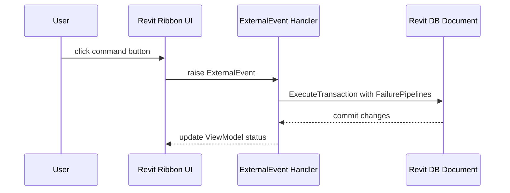

Use this template for writing the PR body:

```markdown
## Summary

<diagram, diff-sketch, or tree>

## Evidence

- **Before:** <screenshot/output/failing test run>
  **After:** <screenshot/output/passing test run>

## Merge Danger

**Door:** <one-way or two-way>

<optional: description>

**Blast Radius:** <one-word description>

<optional: potential ramifications of merge>
```

## Sections

Skip all preambles and keep prose brief. Use the user's domain language from [`GLOSSARY.md`](../../../GLOSSARY.md).

### Summary

Pick the smallest view that makes the key point clear.

- Show logic or an algorithm as pseudocode:

```text
on(save)
  if content is unchanged
    return cached result
  write new content
  return fresh result
```

- Show runtime control flow as a call tree:

```text
ExecuteCommand
  InitializeRevitContext
    BuildRevitDOMTransaction
    ApplyModelChanges
  NotifyUiCompleted
```

- Show UI structure as a UI control tree, including state and module boundaries that matter:

```text
<ExampleWindow> (src/Features/Example/Addin/Views/ExampleWindow.xaml)
  DataContext: ExampleViewModel
  <DockPanel>
    <Button Content="Run Analysis" Command="{Binding RunCommand}" />
    <DataGrid ItemsSource="{Binding Items}" />
```

- Show file responsibility or a broad refactor as a shallow file tree:

```text
src/Features/Example/
├── Core/             # pure ViewModels, models, domain logic, and IExampleAdapter
└── Addin/            # commands, RevitExampleAdapter, and WPF .xaml views
```

- Show module interaction, control flow, or data flow with Mermaid:



- Use `diff` when the point is what changes and the surrounding shape already exists. Match the diff shape to the topic.

For a UI control change:

```diff
 <ExampleWindow>
   <DockPanel>
     <StackPanel>
+      <Button Content="Export Data" />
     <DataGrid ItemsSource="{Binding Items}">
+      <DataGridTextColumn Header="Category" Binding="{Binding CategoryName}" />
```

For a file-layout change:

```diff
 src/Features/Example/
 ├── Core/
+│   └── Services/
+│       └── ExportEngine.cs
-└── OldExportService.cs
 └── Addin/
     ├── Commands/
+    │   └── CmdExportExample.cs
     └── Adapters/
+        └── RevitExampleAdapter.cs
```

For a call-tree or call-stack change:

```diff
 ExecuteCommand
   InitializeRevitContext
+    ValidateExtensibleStorageSchema
     BuildRevitDOMTransaction
-  CommitTransactionDirectly
+  CommitTransactionWithFailuresPreprocessor
```

For a state or control-flow change:

```diff
 on(save)
-  write content
+  if content is unchanged
+    return cached result
+  write new content
+  invalidate cache
```

- Show the whole block when most of it is new, when omitted context would hide ownership or order, or when the user needs a copyable target shape:

```csharp
public Result Execute(ExternalCommandData commandData, ref string message, ElementSet elements)
{
    var uiApp = commandData.Application;
    var doc = uiApp.ActiveUIDocument.Document;
    return Result.Succeeded;
}
```

#### Guidance

Place each visual next to the short text it supports. Keep only the calls, files, props, states, and boundaries needed to answer the user's current question or the options to resolve the current discussion point.

You may use one of these, you may use several, it is unlikely you will use all of them. Use your judgement and don't overwhelm the user.

### Evidence

Concrete evidence that the change works. Show a before and after.

Screenshots are S-tier when the environment is set up for it and the change is visual (WPF windows, ribbon controls, themes).

Execution-based evidence is A-tier: test results from `python .agents/skills/revit-tests/scripts/test_executor.py` (`--version Logic`, `--version <CURRENT_LATEST_VERSION>`, or omitting `--version` to run `Logic` plus all supported **Revit Versions** in [`GLOSSARY.md`](../../../GLOSSARY.md)), or `--assert-clean` journal telemetry output. Show the exact test that now fails and passes.

### Merge Danger

Describe whether it's a one-way or two-way door. You can walk back through two-way doors, but not one-way doors. A PR that is cheap to roll back is lower risk. Changes that involve destructive actions, hard-to-reverse decisions, or Extensible Storage schema modifications (persisted schemas in `.rvt` project files cannot be undone easily) are one-way doors.

The blast radius is the potential impact or scope of the changes introduced by this PR. Consider all possibilities: multi-version compatibility across supported **Revit Versions** (legacy `#if REVIT*` vs. `CURRENT_LATEST_VERSION` in `#else` per [`revit-config.md`](../../../docs/agents/revit-config.md)), multi-TFM compatibility in [`Synthetic.Core.csproj`](../../../src/Synthetic.Core/Synthetic.Core.csproj), breaking changes across `Core/`/`Addin/` seams or **RevitDOM**, or `SyntheticThemeDictionary` UI theme shifts.
