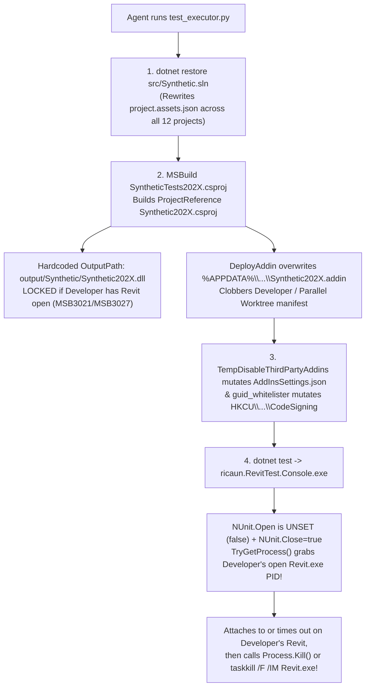

# Feasibility Study: Sandboxing & Parallelizing Autodesk Revit Integration Tests

**Date:** 2026-11-20  
**Scope:** Concurrent AFK + Active Developer Workflows, Multi-Agent Parallel Test Execution, Build/Manifest Isolation, OS & Virtualization Sandboxing, and Licensing Compliance (Revit 2023–2026)  
**Primary Sources Verified:**
- **Repository build & test pipeline:** [test_executor.py](../../.agents/skills/revit-tests/scripts/test_executor.py), [guid_whitelister.py](../../.agents/skills/revit-tests/scripts/guid_whitelister.py), [Synthetic2023.csproj](../../src/Synthetic2023/Synthetic2023.csproj), [Synthetic2024.csproj](../../src/Synthetic2024/Synthetic2024.csproj), [Synthetic2025.csproj](../../src/Synthetic2025/Synthetic2025.csproj), [Synthetic2026.csproj](../../src/Synthetic2026/Synthetic2026.csproj), `src/Synthetic2026/Synthetic2026.addin` (pre-bootstrap manifest, since replaced by `GenerateRevitAddinManifest` in [Directory.Build.targets](../../src/Directory.Build.targets)), [SyntheticTests2023.csproj](../../tests/SyntheticTests2023/SyntheticTests2023.csproj), [SyntheticTests2024.csproj](../../tests/SyntheticTests2024/SyntheticTests2024.csproj), [SyntheticTests2025.csproj](../../tests/SyntheticTests2025/SyntheticTests2025.csproj), [SyntheticTests2026.csproj](../../tests/SyntheticTests2026/SyntheticTests2026.csproj), [SyntheticTests.Logic.csproj](../../tests/SyntheticTests.Logic/SyntheticTests.Logic.csproj), [Tier2_RevitSmokeTests.cs](../../tests/SyntheticTests.Shared/Tier2_RevitSmokeTests.cs), and [TestPathHelper.cs](../../tests/SyntheticTests.Shared/Helpers/TestPathHelper.cs)
- **Installed NuGet & add-in binaries (IL & metadata inspection):** `ricaun.RevitTest.TestAdapter` (`1.11.1`, commit `dc18333f`), embedded `ricaun.RevitTest.Console.exe` (`1.11.1`), `ricaun.RevitTest.Application.bundle` (`1.11.1`, `net48` `2021` & `net8.0` `2025` targets), `ricaun.RevitTest.Command` (`1.11.1`), `ricaun.RevitTest.Shared` (`1.11.1`), `ricaun.NUnit` (`1.5.0`), `ricaun.Revit.Installation` (`1.5.1`), and `ricaun.Revit.UI.Tasks` (`1.0.1`)
- **Workstation state (read-only audit):** Windows 11 Pro (`10.0.26200`), hardware capacity, `Win32_OptionalFeature` states, `C:\Program Files\Autodesk\` installations, `AdskLicensingService`, and `%APPDATA%` / `C:\ProgramData` Revit add-in configurations (`AddInsSettings.json`)
- **Upstream specifications & documentation:** Microsoft Learn Win32 Shell/Desktop/Virtualization docs (`SHGetKnownFolderPath`, `CreateDesktop`, `IVirtualDesktopManager`, Windows Sandbox, Windows Containers, Hyper-V), Autodesk Subscription Terms of Use & Revit CLI/multi-session documentation, Autodesk Platform Services (APS) Design Automation for Revit documentation, and `ricaun-io/ricaun.RevitTest` / `Nice3point/RevitUnit` / `DynamoDS/RevitTestFramework` / `Speckle xUnitRevit` upstream documentation

---

## Executive Summary

Today, running Revit integration tests (or even headless `Logic` tests) while the developer has Autodesk Revit open—or running two AI coding agents simultaneously—fails due to **seven concrete, fixable architectural bottlenecks** in the repository's MSBuild configuration, `.addin` deployment pipeline, and [test_executor.py](../../.agents/skills/revit-tests/scripts/test_executor.py) wrapper—**not** because Windows or Autodesk Revit prohibits concurrent local processes.

### Core Findings

1. **OS-level virtualization (`Windows Sandbox`, `Docker`, `Hyper-V`, `APS Cloud`) and secondary Windows user accounts are either technically blocked, licensing-incompatible, or unnecessary:**
   - **Autodesk Single-User (Named-User) Licensing** permits **multiple concurrent `Revit.exe` processes on the same Windows workstation under the same logged-in Windows user**, but prohibits concurrent active sessions across distinct machines/VMs and malfunctions across concurrent secondary Windows user profiles (`AdskIdentityManager` / `AdskLicensingService` session-token binding).
   - **Windows Sandbox**, **Windows Containers**, and **Win32 `CreateDesktop` / Session 0** fail hard due to missing `HKLM` MSI/licensing state (`AdskLicensingService`) or DirectX 11 / WPF / Chromium `WebView2` (`Webview2 Runtime(145) for Revit`) composition hangs outside an interactive `dwm.exe` desktop.
   - **APS Design Automation (`revitcoreconsole.exe`)** costs paid Flex tokens, is not distributed locally with desktop Revit (verified absent on disk), and lacks `RevitAPIUI.dll` and WPF support required by [Tier2_RevitSmokeTests.cs](../../tests/SyntheticTests.Shared/Tier2_RevitSmokeTests.cs).
2. **`ricaun.RevitTest` (`1.11.1`) already contains the exact primitives needed for zero-interference concurrent execution—and is currently misconfigured:**
   - Because [SyntheticTests2026.csproj](../../tests/SyntheticTests2026/SyntheticTests2026.csproj#L29-L32) sets `NUnit.Close=true` while omitting **`NUnit.Open=true`** (`forceToOpenNewRevit` defaults to `false`), `ricaun.RevitTest.Console` calls `RevitInstallationExtension.TryGetProcess()` (`GetProcesses().FirstOrDefault()`), attaching to or timing out against the **developer's open `Revit.exe`** and then executing `process.Kill()` (followed by [test_executor.py](../../.agents/skills/revit-tests/scripts/test_executor.py#L272) running `taskkill /F /IM Revit.exe`).
   - Internally, `ricaun.RevitTest.Application` uses **per-PID Named Pipes** (`\\.\pipe\ricaun.Revit.<PID>`) and extracts test binaries into unique timestamped `%TEMP%\RevitTest\*_<Ticks:X>` folders (`ZipExtension.ExtractToTempFolder`), meaning **test DLLs are never file-locked in `bin/`**.
3. **Distinguishing "Persistent Warm Daemon" vs. "Pre-Booted Idle Standby Worker Pool" solves the 30–45s Revit boot bottleneck without stale-assembly bugs:**
   - Reusing an already-used `Revit.exe` across code edits (`NUnit.Close=false`) **fails** when `Synthetic202X.dll` changes because `ricaun.NUnit` loads referenced assemblies into `AppDomain.CurrentDomain` / `AssemblyLoadContext.Default` (`AssemblyExtension.TryLoadAssemblyName`), which cannot unload or replace an already-loaded `Synthetic202X` assembly (and `.NET Framework 4.8` `AppDomain` isolation cannot marshal unmanaged C++/CLI `RevitAPI` handles).
   - Conversely, a **Pre-Booted Idle Standby Worker Pool (Single-Use-Per-Build Recycle)** boots 1–2 background `/nosplash` minimized `Revit.exe` workers to idle **before** any agent builds—with `Synthetic` startup loading bypassed via an environment variable (`SYNTHETIC_TEST_WORKER=1`). When an agent finishes building, it leases a warm idle worker by PID, streams its freshly compiled `SyntheticTests202X.dll` + `Synthetic202X.dll` over `\\.\pipe\ricaun.Revit.<WorkerPID>`, **executes in ~1–3 seconds (0s boot wait)**, terminates *only* that consumed worker PID, and triggers asynchronous background replenishment.

### Recommended `$0` Target Architecture

Combine three zero-cost layers on the existing Windows 11 Pro host:
1. **Per-Run Isolated MSBuild Outputs + Shadow-Copy Developer Bootstrap (`.addin`):** Parameterize `OutDir`/`BaseIntermediateOutputPath` and `SkipDeployAddin=true` for agent/test builds so `output/Synthetic/` and `%APPDATA%\Autodesk\Revit\Addins\` are never touched by test runs; optionally wrap developer `Debug` loading in a tiny shadow-copy bootstrap (`Synthetic.Bootstrap`) so the developer's open Revit never locks `output/Synthetic/Synthetic202X.dll` either.
2. **Process-Targeted Concurrent Execution (`NUnit.Open=true` + Permanent `CodeSigning` & `ApplicationPlugins`):** Eliminate `AddInsSettings.json` toggling, `CodeSigning` registry deletion, `PackageContents.xml` deletion races, and `taskkill /IM Revit.exe`.
3. **Pre-Booted Idle Standby Worker Pool (`/nosplash` + Non-Activating/Virtual-Desktop Window Placement):** Keep 1–2 idle standby `Revit.exe` workers warm (`~1.2–1.8 GB` RAM each on a 63.7 GB host with 38.7 GB free) for near-instant (~1–3s) multi-agent test execution with zero UI focus stealing.

---

## 1. Workstation Baseline & Environment Audit

Read-only inspection of the local development host establishes the exact hardware, OS, licensing, and add-in baseline:

| Dimension | Verified Local State | Architectural Implication |
| :--- | :--- | :--- |
| **Operating System** | Microsoft Windows 11 Pro (`10.0.26200`, Build `26200`) | Supports Hyper-V, Windows Sandbox, Virtual Desktops (`IVirtualDesktopManager`), Job Objects, and Local Accounts at `$0` OS cost. |
| **CPU** | Intel Core Ultra 7 265K (`20` physical cores / `20` logical processors) | Ample multi-core headroom for parallel MSBuild compilations + 1–3 concurrent `Revit.exe` instances alongside active modeling. |
| **Memory (RAM)** | `63.7 GB` Total (`38.7 GB` currently free physical RAM) | Idle `Revit.exe` consumes `~1.2–2.0 GB` RAM; hosting 2 standby workers (`~3.5 GB`) uses `<10%` of free RAM. |
| **Disk Free Space** | `C:` `608.7 GB` free (`312.9 GB` used); `G:` `578.2 GB` free | Ample NVMe headroom for isolated per-agent build artifacts, git worktrees, or VM differencing disks if ever desired. |
| **Optional Features** | `Microsoft-Hyper-V`, `Microsoft-Hyper-V-All`, `Containers-DisposableClientVM` (Windows Sandbox), `Containers`, `VirtualMachinePlatform` all `InstallState = 2` (**Disabled**); `hvhost` service running; `vmms` / `WindowsSandbox.exe` absent until enabled | Enabling Hyper-V or Windows Sandbox requires elevated feature activation + host reboot; process-level isolation requires **zero** OS feature changes or reboots. |
| **Installed Revit Versions** | `Revit 2023`, `Revit 2024`, `Revit 2025`, `Revit 2026`, `Revit 2027` + `Webview2 Runtime(145) for Revit` + `eTransmit for Revit 2023–2026` | Multi-version testing across `net48` (2023–2024) and `net8.0-windows8.0` (2025–2026) can run completely locally. |
| **`revitcoreconsole.exe`** | **Not present** anywhere under `C:\Program Files\Autodesk\` | Desktop Revit does not ship the headless APS Design Automation engine; all local Revit API tests must run inside `Revit.exe`. |
| **Licensing Services** | `AdskLicensingService` (`Running`, `Automatic`), `AdskIdentityManager` installed | Named-User (Single-User) subscription active via local desktop licensing service + WebView2 OAuth identity manager. |
| **Third-Party Add-in Load Overhead** | Per Revit 2026 `AddInsSettings.json`: `CTC BIM Project Suite` (`15,406 ms`), `Keynote Manager +` (`1,892 ms`), `KM+ Keynote DB Server` (`1,892 ms`), `Kinship` (`935 ms`), `Enscape` (`466 ms`), `Bluebeam` (`156 ms`) | **20.7 seconds** of every cold Revit 2026 startup is spent initializing third-party add-ins unrelated to `Synthetic`. |

---

## 2. Root-Cause Diagnosis of Current Contention Points

Inspecting this repository's build scripts and reflecting over the locally cached `ricaun.RevitTest` `1.11.1` assemblies reveals **seven distinct failure modes** that block concurrent human + multi-agent workflows today.



### 2.1 Hardcoded `OutputPath` (`output\Synthetic\`) & In-Place `signtool.exe` Locking

In [Synthetic2023.csproj](../../src/Synthetic2023/Synthetic2023.csproj#L25), [Synthetic2024.csproj](../../src/Synthetic2024/Synthetic2024.csproj#L30), [Synthetic2025.csproj](../../src/Synthetic2025/Synthetic2025.csproj#L9), and [Synthetic2026.csproj](../../src/Synthetic2026/Synthetic2026.csproj#L9), `<OutputPath>..\..\output\Synthetic\</OutputPath>` and `<DocumentationFile>..\..\output\Synthetic\Synthetic202X.xml</DocumentationFile>` are unconditionally hardcoded.

- Although [SyntheticTests2026.csproj](../../tests/SyntheticTests2026/SyntheticTests2026.csproj#L5-L6) redirects its own `OutputPath` to `$(LocalAppData)\Temp\bin\SyntheticTests2026_ff610c80\`, it retains `<ProjectReference Include="..\..\src\Synthetic2026\Synthetic2026.csproj" />` (as does headless [SyntheticTests.Logic.csproj](../../tests/SyntheticTests.Logic/SyntheticTests.Logic.csproj#L21)).
- When the developer has Revit 2026 open with `%APPDATA%\Autodesk\Revit\Addins\2026\Synthetic2026.addin` pointing to `<RepoRoot>\output\Synthetic\Synthetic2026.dll`, Windows memory-maps `Synthetic2026.dll` into `Revit.exe`. Any MSBuild run—**even headless `--version Logic`**—attempts to overwrite `output\Synthetic\Synthetic2026.dll` and run `signtool.exe` ([Synthetic2026.csproj](../../src/Synthetic2026/Synthetic2026.csproj#L126)), failing with `MSB3027` / `MSB3021` file-lock errors.
- Furthermore, two agents building simultaneously collide on `src/Synthetic202X/obj/`, `output/Synthetic/`, and the static `SyntheticTests2026_ff610c80` temp folder.

### 2.2 Unconditional `%APPDATA%` `.addin` Clobbering & `TestPathHelper` Reversal

1. **`DeployAddin` MSBuild target ([Synthetic2026.csproj](../../src/Synthetic2026/Synthetic2026.csproj#L82-L98)):** Every `Debug` build rewrites `<Assembly>` and copies `Synthetic202X.addin` directly into `$(AppData)\Autodesk\Revit\Addins\$(RevitVersion)\`. Concurrent builds from separate git worktrees overwrite the developer's active `.addin` registration.
2. **Inverted lookup order in [TestPathHelper.cs](../../tests/SyntheticTests.Shared/Helpers/TestPathHelper.cs#L11-L48):** `TestPathHelper.GetProjectRoot()` scans `%APPDATA%\Autodesk\Revit\Addins\*\Synthetic*.addin` **first** (lines 11–35) *before* checking `SYNTHETIC_PROJECT_ROOT` (line 37) or walking up `TestContext.CurrentContext.TestDirectory` (line 43). An agent running in a secondary git worktree will silently read test fixtures (`Assets\test_duplicate_families.json`, etc.) from whichever worktree last wrote `%APPDATA%\...\Synthetic2026.addin`.

### 2.3 Dual `ProgramData` + `AppData` `Synthetic` Manifests & Startup `AppDomain` Shadowing

Inspection of the workstation's add-in directories and Revit 2026 `AddInsSettings.json` revealed **two** simultaneous `Synthetic` registrations:
1. `C:\ProgramData\Autodesk\Revit\Addins\2026\Synthetic2026.addin` (`ClientId` `4fd5b26e-1325-460f-97b1-878804070868` -> `C:\ProgramData\Autodesk\Revit\Addins\Synthetic\Synthetic2026.dll`, `LoadTime: 48 ms`)
2. `%APPDATA%\Autodesk\Revit\Addins\2026\Synthetic2026.addin` (`ClientId` `4fd5b26e-1325-460f-97b1-878804070869` -> `<RepoRoot>\output\Synthetic\Synthetic2026.dll`, `LoadTime: 35 ms`)

And in [test_executor.py](../../.agents/skills/revit-tests/scripts/test_executor.py#L47), `TempDisableThirdPartyAddins` explicitly leaves `vendor == "net.amcgoey" or name == "Synthetic"` **enabled** when launching Revit for tests!

**Why this breaks isolated test builds (verified in `ricaun.NUnit` `1.5.0` IL):**
- Inside `ricaun.NUnit.Extensions.AssemblyExtension.LoadReferencedAssemblies`, `TryLoadAssemblyName` checks `AppDomain.CurrentDomain.GetAssemblies()` *before* calling `Assembly.LoadFile` on DLLs in the zip-extracted test folder, and [Tier2_RevitSmokeTests.cs](../../tests/SyntheticTests.Shared/Tier2_RevitSmokeTests.cs#L35) calls `Type.GetType("..., Synthetic2026")`.
- If a test `Revit.exe` loads `Synthetic2026.dll` at startup from `ProgramData` or `<RepoRoot>\output\Synthetic\`, **`AppDomain.CurrentDomain` already contains that stale startup `Synthetic2026` assembly**, shadowing the newly compiled `Synthetic2026.dll` packaged alongside `SyntheticTests2026.dll`!
- Test workers **must not** load `Synthetic202X.dll` via startup `.addin` manifests; `Synthetic202X.dll` should only be loaded from the isolated test payload directory when `ricaun.NUnit` executes the test assembly.

### 2.4 `ricaun.RevitTest` Process Hijacking (`NUnit.Open` Missing) & Timeout Key Mismatch

IL inspection of `ricaun.RevitTest.Console.Revit.Utils.RevitTestUtils.CreateRevitServer` (`1.11.1`) reveals the exact process-selection branch (`IL_01EE`–`IL_0255` and `IL_05C0`–`IL_05F4`):

```csharp
// Reconstructed from verified IL in ricaun.RevitTest.Console.exe (v1.11.1):
if (!revitInstallation.TryGetProcess(out Process process) || forceToOpenNewRevit) // forceToOpenNewRevit == NUnit.Open
{
    string args = string.Join(" ", RevitLanguageUtils.GetArgument(forceLanguageToRevit), EnvironmentVariable.ProcessArguments);
    process = revitInstallation.Start(args);
}
using var client = new PipeTestClient(process); // Connects to "\\.\pipe\ricaun.Revit.<process.Id>"
// ... runs tests ...
if (forceToCloseRevit) // forceToCloseRevit == NUnit.Close
{
    if (!process.HasExited) { Thread.Sleep(1000); process.Kill(); }
}
```

1. **Missing `NUnit.Open=true`:** All four `SyntheticTests202X.csproj` files set `<AssemblyMetadata Include="NUnit.Close" Value="true" />` without setting `NUnit.Open` (which defaults to `false` in `RunSettingsModel.NUnitModel`). If the developer has Revit 2026 open, `TryGetProcess()` (`GetProcesses().FirstOrDefault()`) selects the **developer's `Revit.exe` PID**. If `ricaun.RevitTest.Application` is not loaded in the developer's Revit, it hangs until `TimeoutNotBusyMaxSeconds` and **calls `process.Kill()` on the developer's Revit**; if it *is* loaded, it executes tests inside the developer's live session and **still calls `process.Kill()` on exit**!
2. **Unrecognized timeout metadata key:** `SyntheticTests202X.csproj` sets `<AssemblyMetadata Include="ricaun.RevitTest.Timeout" Value="600000" />`. Inspection of `RunSettingsModel.NUnitModel` and `TestExecuteUtils.ConfigurationMetadata` confirms `1.11.1` only recognizes:
   - `NUnit.Timeout` (double, **in minutes**, adapter/console timeout; env override `RICAUN_REVITTEST_TESTADAPTER_NUNIT_TIMEOUT`)
   - `ricaun.RevitTest.Application.Tasks.Timeout` (double, **in minutes**, per-test `ExternalEvent` task timeout)
   - `RICAUN_REVITTEST_CONSOLE_TIMEOUT_NOT_BUSY_MAX_SECONDS` (int, seconds to wait for pipe connection after process start)

### 2.5 Indiscriminate `taskkill /F /IM Revit.exe`

On timeout (660s), [test_executor.py](../../.agents/skills/revit-tests/scripts/test_executor.py#L272) runs `taskkill /F /IM Revit.exe`, terminating **every** `Revit.exe` process across all Revit versions (developer sessions and sibling agent test workers alike) rather than terminating the `dotnet test` child process tree by PID.

### 2.6 Shared Mutable State Races Across Parallel Runs

Running two instances of [test_executor.py](../../.agents/skills/revit-tests/scripts/test_executor.py) concurrently triggers five immediate races:
1. **`ApplicationPluginsDisposable.Dispose` (`DeletePackageContents`) race:** In `ricaun.Revit.Installation.ApplicationPluginsUtils.DeleteBundle` (`IL_0049`–`IL_0050`), when Agent A's `ricaun.RevitTest.Console.exe` exits, it deletes `PackageContents.xml` inside `%APPDATA%\Autodesk\ApplicationPlugins\ricaun.RevitTest.Application.bundle\`. If Agent B's newly spawned `Revit.exe` is mid-startup, Revit fails to discover `ricaun.RevitTest.Application` and hangs until timeout.
2. **`AddInsSettings.json` backup/restore race:** [test_executor.py](../../.agents/skills/revit-tests/scripts/test_executor.py#L150-L154) unconditionally restores `AddInsSettings.json.bak` across versions 2023–2026 on startup, clobbering any active test boot; conversely, if the developer opens Revit during a test run, their third-party add-ins open disabled.
3. **`HKCU\...\CodeSigning` cleanup race:** [guid_whitelister.py](../../.agents/skills/revit-tests/scripts/guid_whitelister.py#L137-L155) deletes whitelisted publisher GUIDs from `HKCU` when Agent A exits, causing Agent B's booting `Revit.exe` to pop a modal `"Security - Unsigned Add-In"` dialog that blocks unattended execution.
4. **Shared `tests/TestResults/` wipe:** [test_executor.py](../../.agents/skills/revit-tests/scripts/test_executor.py#L200-L207) deletes all `results_*.trx` files on startup and writes fixed filenames `results_2026.trx` and `output_2026.log`.
5. **Unconditional `dotnet restore src/Synthetic.sln`:** Rewrites `obj/project.assets.json` across all 12 projects on every single test invocation, racing with concurrent MSBuild executions.

### 2.7 Desktop UI Focus Stealing

`RevitInstallationExtension.Start` launches `Revit.exe` without `/nosplash` and with default `ShowWindow` activation on `WinSta0\Default`. Revit's topmost splash screen and main DirectX/WPF frame steal foreground window focus from the developer's IDE or active Revit window.

---

## 3. Evaluation of Candidate Sandboxing & Parallelization Methods

### Method 1: Headless Logic Tier Offloading (`SyntheticTests.Logic` + `RevitAPIMock`)

- **Mechanics:** Runs pure C#, MVVM ViewModels, JSON serialization, and `RevitAPIMock`-backed unit tests under standard `dotnet test` (`NUnit3TestAdapter`) on `.NET 8` without launching `Revit.exe` ([SyntheticTests.Logic.csproj](../../tests/SyntheticTests.Logic/SyntheticTests.Logic.csproj)).
- **Concurrency & Speed:** Executes in **1–3 seconds** with unlimited multi-agent parallelism once `OutDir` / `BaseIntermediateOutputPath` are isolated so MSBuild no longer writes to `output\Synthetic\Synthetic2026.dll`.
- **Limitations:** Cannot validate real unmanaged Revit transactions, `FilteredElementCollector` behavior, geometry kernels, failure preprocessors, or `ExtensibleStorage`. Necessary as Tier 1 of the test pyramid (already codified in [SKILL.md](../../.agents/skills/revit-tests/SKILL.md)), **not** a substitute for Tier 2 Revit integration tests.

### Method 2: Same-Session Process-Isolated Cold Workers (`NUnit.Open=true` + Isolated Build & Bootstrap)

- **Mechanics:**
  1. **Concurrent `Revit.exe` support on Windows:** Official Autodesk documentation confirms multiple `Revit.exe` instances can run simultaneously under the same Windows user. Each `Revit.exe` writes to a PID/sequence-unique journal file (`%LOCALAPPDATA%\Autodesk\Revit\Autodesk Revit <Year>\Journals\journal.XXXX.txt`) without locking conflicts, provided tests create/open isolated temp `.rvt` files rather than opening the same non-workshared `.rvt` file or syncing the same workshared central model.
  2. **Why `%APPDATA%` cannot be overridden per process:** Windows `SHGetKnownFolderPath(FOLDERID_RoamingAppData, ..., hToken=NULL)` resolves `%APPDATA%\Autodesk\Revit\Addins\<Year>` from the user's security token/profile registry hive rather than reading the `%APPDATA%` environment variable. Changing `env["APPDATA"]` on a child `Revit.exe` does **not** redirect `.addin` discovery (and destabilizes Win32/CLR components that read `%APPDATA%`).
  3. **Solving `.addin` & DLL isolation without `%APPDATA%` redirection:**
     - Test builds pass `-p:OutDir=<UniqueAgentRunDir>` and `-p:SkipDeployAddin=true`, never touching `output/Synthetic/` or `%APPDATA%\Autodesk\Revit\Addins\`.
     - Replace the developer's `%APPDATA%\Autodesk\Revit\Addins\<Year>\Synthetic202X.addin` target with a tiny, unchanging **Shadow-Copy Bootstrap Add-in** (`Synthetic.Bootstrap202X.dll`, ~60 LOC):
       - **In a test worker (`SYNTHETIC_TEST_WORKER=1` inherited env var):** `OnStartup` immediately returns `Result.Succeeded` **without loading `Synthetic202X.dll`**, guaranteeing `AppDomain.CurrentDomain` stays clean until `ricaun.NUnit` loads the agent's freshly built `Synthetic202X.dll` from its zip-extracted temp folder.
       - **In the developer's interactive Revit (`SYNTHETIC_TEST_WORKER` unset):** `OnStartup` copies `output\Synthetic\Synthetic202X.*` into `%LOCALAPPDATA%\Temp\SyntheticDevShadow\<PID>\` and calls `Assembly.LoadFrom` from that shadow folder, **permanently eliminating `output\Synthetic\Synthetic202X.dll` file locks even for normal `Debug` builds!**
  4. **Process isolation via `NUnit.Open=true` + `RICAUN_REVITTEST_CONSOLE_PROCESS_ARGUMENTS="/nosplash"`:** Forces `ricaun.RevitTest.Console` to spawn a dedicated `Revit.exe` PID, bind `\\.\pipe\ricaun.Revit.<ChildPID>`, and kill *only* that child PID upon completion.
  5. **Eliminating `ApplicationPlugins` teardown races:** Installing `ricaun.RevitTest.Application.bundle` (`1.11.1`) into `C:\ProgramData\Autodesk\ApplicationPlugins\` (which `ApplicationPluginsDisposable.Dispose` never deletes, since it only targets `GetCurrentUserApplicationPluginsFolder()`) ensures `PackageContents.xml` is always available to concurrent worker boots.
- **Licensing Compliance:** **100% compliant**—runs on the single licensed workstation under the single Named User's active session.
- **Performance:** ~25–45s per run (cold Revit startup; ~10–20s faster if heavy third-party add-ins like `CTC BIM Project Suite` are disabled or bypassed).
- **UI Focus Impact:** `/nosplash` eliminates the topmost splash popup, but `RevitInstallationExtension.Start` (`UseShellExecute=true`, normal window state) still briefly activates the main Revit window at frame creation unless paired with a window-suppression hook (see Method 3).

### Method 3: Pre-Booted Idle Standby Worker Pool vs. Persistent Warm Daemon (`$0` Recommended Architecture)

#### Why a Naive "Persistent Warm Daemon" (`NUnit.Close=false`) Fails After Code Edits
Keeping a single `Revit.exe` open with `NUnit.Close=false` and re-running `dotnet test` against it works *only* when modifying `SyntheticTests202X` while `Synthetic202X.dll` is unchanged—and **still fails** in two critical ways:
1. **CLR Assembly Caching (`AppDomain` / Default `AssemblyLoadContext`):** Once Run #1 loads `Synthetic2026.dll` into `Revit.exe`'s default CLR context (`AssemblyExtension.TryLoadAssemblyName`), Run #2 **cannot unload or overwrite `Synthetic2026` in memory**. Any edits to `src/SyntheticShared/` compiled into a new `Synthetic2026.dll` are silently ignored on Run #2 (or throw `InvalidCastException` if loaded into a custom `.NET 8` collectible `AssemblyLoadContext` while static state or `Type.GetType("..., Synthetic2026")` resolves against the default context). Moreover, Revit 2023–2024 run on `.NET Framework 4.8`, where unloading requires a secondary `AppDomain`—which is **architecturally impossible** for Revit API tests because `Autodesk.Revit.UI.UIApplication` and `Autodesk.Revit.DB.Document` wrap unmanaged C++ pointers and are neither `[Serializable]` nor `MarshalByRefObject`.
2. **`TryGetProcess().FirstOrDefault()` Ambiguity:** With `NUnit.Open=false`, `ricaun.RevitTest.Console` picks the *first* `Revit.exe` returned by `Process.GetProcesses()`, which can collide with the developer's open Revit session or another agent's worker.

#### How the "Pre-Booted Idle Standby Worker Pool" Solves Both Latency and Assembly Isolation
By decoupling **Revit Boot (`~30s`)** from **Assembly Loading (`~0.2s`)**:

```mermaid
sequenceDiagram
    participant PM as Standby Pool Manager
    participant W1 as Standby Revit Worker (PID 20400)
    participant Ag as AI Coding Agent
    participant W2 as Replacement Worker (PID 21900)

    Note over PM,W1: Background pre-boot (/nosplash, minimized/VirtualDesktop,<br/>SYNTHETIC_TEST_WORKER=1 -> Synthetic2026.dll NOT loaded!)
    PM->>W1: Spawn Revit.exe -> ricaun.RevitTest.Application listens on \\.\pipe\ricaun.Revit.20400
    Ag->>Ag: Edit C# + MSBuild to isolated OutDir (2–4s)
    Ag->>PM: Request Revit 2026 Worker Lease
    PM-->>Ag: Lease PID 20400 (0s wait!)
    PM->>W2: Asynchronously spawn replacement standby worker in background
    Ag->>W1: Send TestRequest { TestPathFile, TestFilters } over \\.\pipe\ricaun.Revit.20400
    Note over W1: Zips isolated OutDir -> extracts to %TEMP% -> loads fresh<br/>Synthetic2026.dll + SyntheticTests2026.dll for the FIRST time!
    W1-->>Ag: Stream TestResponse NUnit results (1–3s)
    Ag->>W1: Kill ONLY PID 20400 (clean slate; zero leaked memory/dialogs)
```

- **Why this works cleanly in `ricaun.RevitTest` `1.11.1`:**
  - `ricaun.RevitTest.Application` starts its Named Pipe server (`\\.\pipe\ricaun.Revit.<PID>`) inside `OnStartup` / `Idling` without loading any test or `Synthetic` DLLs.
  - Because `SYNTHETIC_TEST_WORKER=1` tells the bootstrap `.addin` to skip loading `Synthetic202X.dll` at startup, **neither `Synthetic202X.dll` nor `SyntheticTests202X.dll` exists in `Revit.exe`'s CLR while it sits idle in the pool!**
  - When an agent leases `WorkerPID` and connects `PipeTestClient` directly to `\\.\pipe\ricaun.Revit.<WorkerPID>` (using `ricaun.RevitTest.Shared.dll` or a ~150-LOC C# runner CLI), `ricaun.RevitTest.Application` loads the agent's freshly compiled `Synthetic202X.dll` + `SyntheticTests202X.dll` into a pristine CLR, runs all tests in **1–3 seconds**, returns TRX/JSON results, and terminates `WorkerPID`.
- **Preventing UI Focus Stealing on `WinSta0\Default` (Without Breaking DirectX / WPF / WebView2):**
  - **Why Win32 `CreateDesktop` (`WinSta0\HiddenDesktop`) and Session 0 fail:** Revit 2023–2026 initializes DirectX 11 hardware surfaces, WPF `HwndSource`s, and Chromium `WebView2` (`Webview2 Runtime(145) for Revit`). On Session 0 or an uncomposed secondary Win32 `HDESK` where `dwm.exe` is not actively pumping desktop composition, DirectX / WebView2 / WPF window creation hangs or throws `0x8007139F`. Furthermore, [Tier2_RevitSmokeTests.cs](../../tests/SyntheticTests.Shared/Tier2_RevitSmokeTests.cs#L102-L107) explicitly invokes `window.Show()` and asserts `window.IsVisible == true`.
  - **What works reliably on `WinSta0\Default`:**
    1. Launch `Revit.exe /nosplash` via Win32 `CreateProcess` with `STARTUPINFO.dwFlags = STARTF_USESHOWWINDOW` and `wShowWindow = SW_SHOWMINNOACTIVE` (`7`) (or `ProcessWindowStyle.Minimized`).
    2. Attach a lightweight WinEvent hook (`SetWinEventHook` for `EVENT_OBJECT_SHOW`, filtered by `dwProcessId == workerPid`) in the Pool Manager (or inside a tiny worker helper add-in on `ApplicationInitialized`) that immediately calls `ShowWindowAsync(hwnd, SW_SHOWNOACTIVATE)` at off-screen coordinates (`SetWindowPos` `X = -32000, Y = -32000`, `SWP_NOACTIVATE | SWP_NOSIZE | SWP_NOZORDER`) **or** moves the worker's top-level `HWND` to a dedicated **Windows 11 Virtual Desktop** (`IVirtualDesktopManager::MoveWindowToDesktop` COM API, `{A5CD92FF-29BE-454C-8D04-D82879FB3F1B}`). DWM, DirectX 11, WebView2, and WPF `window.IsVisible == true` all remain 100% functional with **zero focus stealing** on the developer's active desktop!

### Method 4: Alternative Open-Source Revit Test Runners

| Runner | Test Engine | .NET 8 / Revit 2025–2026 | CLI / `dotnet test` | Multi-Instance / Parallel Isolation | Verdict for This Repo |
| :--- | :--- | :--- | :--- | :--- | :--- |
| **`ricaun.RevitTest` (`1.11.1`)** *(Current)* | NUnit 3 (`3.13.3`) | Native (`2019`–`2029` in bundle) | Native (`TestAdapter` + `Console`) | Per-PID pipes (`ricaun.Revit.<PID>`) + `NUnit.Open=true` + temp zip shadow-copy | **Keep.** Already integrated; all current issues stem from missing `NUnit.Open=true` and repo MSBuild/script config. |
| **`Nice3point.TUnit.Revit`** | TUnit (`Microsoft.Testing.Platform`) | Native (modern .NET focus; drops legacy patterns) | Native (`dotnet test`) | Named-pipe session hooks; still bound by Revit startup & `.addin` contention | **Do not migrate.** Requires rewriting all 40+ NUnit test fixtures (`[TestFixture]`, `Assert.*`) to TUnit—and does **not** support `net48` Revit 2023–2024 the same way without dual test frameworks. |
| **`Speckle xUnitRevit`** | xUnit | Community forks only (upstream archived) | Manual in-Revit WPF runner | Interactive GUI-oriented; poor unattended multi-agent automation | **Reject.** Archived upstream; requires xUnit rewrite and lacks native `dotnet test` adapter lifecycle. |
| **`DynamoDS/RevitTestFramework`** | NUnit (legacy) | Broken on .NET 8 (Revit 2025+) without heavy patching | Journal + custom console | Fragile journal playback; hangs on modal dialogs | **Reject.** Effectively unmaintained for modern .NET 8 Revit releases. |
| **Raw Revit Journal Automation** | Custom journal `.txt` | Supported by `Revit.exe` | Custom script | Journal playback conflicts with `/nosplash` and breaks easily on UI changes | **Reject.** Inferior to Named Pipe `ExternalEvent` RPC already provided by `ricaun.RevitTest`. |

### Method 5: Secondary Local Windows User Account (`RevitTestWorker`)

- **Mechanics:** Create a local Windows account (e.g., `RevitTestWorker`) so `SHGetKnownFolderPath(FOLDERID_RoamingAppData)` and `HKCU` naturally resolve to `<WorkerProfile>\AppData\Roaming\` and `RevitTestWorker`'s registry hive.
- **Hard Blockers & Friction Verified Against Primary Sources:**
  1. **Non-interactive spawning (`CreateProcessWithLogonW` / Service / non-interactive Scheduled Task) hangs DirectX & WebView2:** Without an active interactive desktop session (`dwm.exe`), `Revit.exe` and `AdskIdentityManager` (WebView2) hang or exit with `"There is no user connected to Revit"`.
  2. **Interactive secondary session (Fast User Switching / local RDP loopback on Windows 11 Pro):** Windows 11 Pro enforces a single concurrent active console/RDP interactive user session (connecting via local RDP locks the physical developer's console screen unless unsupported system-file termsrv modifications are used, which are strictly off-limits). Even with Fast User Switching (`tscon` / disconnected background session), **Autodesk Desktop Licensing Service (`AdskLicensingService`) + `AdskIdentityManager`** bind the single-user OAuth session token to the active Windows user profile; running `Revit.exe` simultaneously under User A and User B on the same machine triggers `AdskLicensingService` authorization failures, IPC permission errors, and violates Single-User Named-User identity correspondence.
- **Verdict:** **Not recommended.** High fragility and licensing friction for problems (`%APPDATA%` `.addin` and `HKCU\...\CodeSigning`) that are solved cleanly in the primary user profile via `SkipDeployAddin=true`, bootstrap env vars, and persistent `CodeSigning` whitelisting.

### Method 6: Windows Sandbox (`.wsb`)

- **Mechanics:** Ephemeral lightweight desktop VM built into Windows 11 Pro (`Containers-DisposableClientVM`), mounting host folders via `<MappedFolders>`.
- **Hard Blockers:**
  1. **Missing `HKLM` Registry, MSI Product Registrations, & Side-by-Side Runtimes:** Simply mapping `C:\Program Files\Autodesk` as `<ReadOnly>true</ReadOnly>` inside `.wsb` **cannot launch `Revit.exe`**. Revit requires hundreds of `HKLM\SOFTWARE\Autodesk` registry keys, Windows Installer (`MsiEnumProducts`) product codes (which `ricaun.Revit.Installation` also queries!), VC++ / .NET Desktop runtimes, and COM registrations absent from Windows Sandbox's pristine OS image.
  2. **Missing `AdskLicensingService` & Ephemeral OAuth Sign-In:** `AdskLicensingService` is a system Windows Service backed by encrypted state in `C:\ProgramData\Autodesk\AdskLicensingService`. Installing Revit + Licensing inside every ephemeral `.wsb` boot takes 15–30 minutes and forces interactive human `AdskIdentityManager` 2FA login on every boot.
- **Verdict:** **Infeasible (Hard Blocker).**

### Method 7: Local Hyper-V Virtual Machines (Differencing VHDX + Warm Checkpoints + GPU-P)

- **Mechanics:** Windows 11 Pro includes full Hyper-V (`Microsoft-Hyper-V-All`, `$0` hypervisor). With `63.7 GB` RAM and `608 GB` free NVMe space, the host *hardware* could physically run 1–2 Generation 2 Hyper-V VMs (`12 GB` RAM each, GPU-Partitioning `Add-VMGpuPartitionAdapter` for DirectX 11) restored from warm checkpoints.
- **Hard Blockers & Cost/Compliance Constraints:**
  1. **Autodesk Single-User Subscription Concurrent Device Rule:** Under Autodesk's Terms of Use for Single-User (Named-User) subscriptions, while software may be *installed* on multiple computers/VMs, **active concurrent sessions across more than one device/VM at the same time are prohibited** and trigger Autodesk licensing seat-limit warnings (`"Device limit reached"` / session pause prompts) when the host and 1+ VMs with distinct machine fingerprints phone home concurrently.
  2. **Non-Zero Licensing & Maintenance Overhead:** Windows 11 Pro host licenses do **not** include free Windows 11 Pro guest activation rights (unlike Windows Server Datacenter AVMA); maintaining Revit 2023–2026 (`~120+ GB`) inside base VHDX images + refreshing expired `AdskIdentityManager` OAuth tokens across VM checkpoint rollbacks creates heavy ongoing operational toil.
- **Verdict:** **Viable only if the organization holds extra Named-User/Flex seats and Windows guest licenses**, and strictly inferior to same-host process isolation + standby worker pooling for `$0` concurrent development.

### Method 8: Windows Containers (Docker)

- **Mechanics:** Process-isolated or Hyper-V-isolated Windows Server Core / Windows base containers.
- **Hard Blockers:** Windows Containers lack an interactive `WinSta0` desktop, Explorer shell, and `dwm.exe` compositor. Win32 GUI + WPF + DirectX 11 + WebView2 (`Revit.exe` + `AdskIdentityManager`) cannot render interactive window stations or complete desktop OAuth licensing inside containers.
- **Verdict:** **Infeasible (Hard Blocker).**

### Method 9: Cloud APS Design Automation for Revit (`revitcoreconsole.exe`)

- **Mechanics:** Upload AppBundles + test `.rvt` payloads to Autodesk Platform Services cloud containers running headless `revitcoreconsole.exe` (e.g., via `ricaun.RevitTest.DA`).
- **Hard Blockers for This Codebase & Budget:**
  1. **Non-`$0` Metered Cost:** Consumes paid **Autodesk Flex tokens** per cloud compute hour.
  2. **No `RevitAPIUI.dll`, `UIApplication`, or WPF Support:** Design Automation runs strictly against `RevitDBAPI` inside `revitcoreconsole.exe`. Referencing `UIApplication`, `UIDocument`, `RibbonPanel`, `ExternalEvent`, `TaskDialog`, or instantiating WPF `Window`s (such as `ProjectStandardsDashboardWindow.Show()` in [Tier2_RevitSmokeTests.cs](../../tests/SyntheticTests.Shared/Tier2_RevitSmokeTests.cs#L87-L107)) fails or hangs in APS containers.
  3. **Slow Inner-Loop Latency:** Zipping binaries, uploading to OSS signed URLs, queueing cloud WorkItems, and downloading results adds `30–90s` per TDD iteration and requires internet connectivity.
- **Verdict:** **Unsuitable for local TDD and UI/MVVM integration testing.**

---

## 4. Candidate Comparison Matrix

| Method | Software / License Cost | Setup Effort | Inner-Loop Latency (After Build) | Multi-Agent Parallelism | Zero Interference w/ User's Open Revit | Autodesk Single-Seat Compliance | UI Focus Isolation | Overall Verdict |
| :--- | :--- | :--- | :--- | :--- | :--- | :--- | :--- | :--- |
| **1. Headless `SyntheticTests.Logic` (Isolated `OutDir`)** | `$0` | Very Low (~1 hr) | **~1–3 s** | Unlimited | **Yes** (once `OutDir` isolated) | Yes (No Revit used) | **Complete** (Console) | **Essential Tier 1** (DB logic mocked only) |
| **2. Same-Session Cold Workers (`NUnit.Open=true` + Isolated Build)** | `$0` | **Low (~2–3 hrs)** | ~25–45 s (cold boot) | **2–4 parallel workers** | **Yes** (with Bootstrap `.addin`) | **Yes** (Same user & machine) | Partial (`/nosplash`; brief frame show) | **Recommended Phase 1** (Immediate unlock) |
| **3. Pre-Booted Idle Standby Pool + VirtualDesktop / NoActivate** | `$0` | Moderate (~1–2 days) | **~1–3 s** (0s boot wait!) | **2–4 parallel workers** | **Yes** (PID-targeted pipe + Bootstrap) | **Yes** (Same user & machine) | **Complete** (`SW_SHOWMINNOACTIVE` / Virtual Desktop) | **Recommended Phase 2 Target State** |
| **4. Alternative Runner (`Nice3point.TUnit.Revit`)** | `$0` | High (Rewrite 40+ test files) | ~25–45 s | Same OS limits | Requires same MSBuild fixes | Yes | Partial | **Skip** (High churn, no net isolation gain) |
| **5. Secondary Local Windows Account (`RevitTestWorker`)** | `$0` | High | ~30–50 s | Fragile | Breaks `AdskLicensingService` | **Conflicts** across user profiles | High (if session active) | **Reject** (Session 0 / Licensing blockers) |
| **6. Windows Sandbox (`.wsb`)** | `$0` | N/A | N/A | N/A | Yes | Fails activation | Complete | **Infeasible** (Missing `HKLM` / MSI / Licensing) |
| **7. Hyper-V VMs (Checkpoints + GPU-P)** | Windows Guest License + Extra Seat | High (2–3 days + 120 GB VHDX) | ~5–15 s (from warm VM) | 1 per licensed seat | Yes | **Violates 1-device concurrent rule** on 1 seat | Complete | **Reject for 1-seat `$0` constraint** |
| **8. Windows Containers (Docker)** | `$0` | N/A | N/A | N/A | N/A | Fails activation | N/A | **Infeasible** (No `WinSta0` / DirectX / WebView2) |
| **9. Cloud APS Design Automation (`revitcoreconsole`)** | **Paid** (Flex Tokens) | High | ~30–90 s (upload + queue) | High (Cloud) | Yes | Separate APS billing | Complete | **Reject** (Paid + No `RevitAPIUI` / WPF) |

---

## 5. Tailored Phased Implementation Roadmap

### Phase 1: Zero-Collision Concurrent Builds & Cold-Worker Isolation (~2–3 Hours Effort)

Phase 1 requires **zero custom daemon infrastructure** and immediately unlocks **(a)** running tests while the developer has Revit open with `Synthetic` loaded and **(b)** running multiple AI agents in parallel across separate runs or git worktrees.

1. **Parameterize MSBuild Outputs & Gate `DeployAddin` Across `src/Synthetic202X` and `tests/SyntheticTests*`:**
   - In [Synthetic2023.csproj](../../src/Synthetic2023/Synthetic2023.csproj), [Synthetic2024.csproj](../../src/Synthetic2024/Synthetic2024.csproj), [Synthetic2025.csproj](../../src/Synthetic2025/Synthetic2025.csproj), and [Synthetic2026.csproj](../../src/Synthetic2026/Synthetic2026.csproj):
     - Guard `<OutputPath>` with `Condition="'$(OutputPath)' == ''"` and compute `<DocumentationFile>$(OutputPath)$(AssemblyName).xml</DocumentationFile>` dynamically instead of hardcoding `..\..\output\Synthetic\`.
     - Add `Condition="'$(SkipDeployAddin)' != 'true'"` to the `DeployAddin` and `AfterClean` targets so agent test builds **never touch** `%APPDATA%\Autodesk\Revit\Addins\$(RevitVersion)\`.
   - Remove the hardcoded `SyntheticTests2026_ff610c80` path from [SyntheticTests2026.csproj](../../tests/SyntheticTests2026/SyntheticTests2026.csproj#L5-L6) and pass per-invocation isolated `BaseIntermediateOutputPath` and `OutDir` (e.g., `%LOCALAPPDATA%\Temp\SyntheticTestRuns\<RunGuid>\`) from [test_executor.py](../../.agents/skills/revit-tests/scripts/test_executor.py) when building test projects (including `--version Logic`!).
2. **Fix `TestPathHelper.GetProjectRoot()` Lookup Priority:**
   - In [TestPathHelper.cs](../../tests/SyntheticTests.Shared/Helpers/TestPathHelper.cs), check `SYNTHETIC_PROJECT_ROOT` **first**, walk up `TestContext.CurrentContext.TestDirectory` **second**, and keep `%APPDATA%\Autodesk\Revit\Addins\` only as a last-resort fallback so git worktrees always read their own repo root.
3. **Fix `ricaun.RevitTest` Metadata & Environment Variables:**
   - In all `tests/SyntheticTests202X/SyntheticTests202X.csproj`:
     ```xml
     <ItemGroup>
       <AssemblyMetadata Include="NUnit.Version" Value="2026" />
       <AssemblyMetadata Include="NUnit.Open" Value="true" />
       <AssemblyMetadata Include="NUnit.Close" Value="true" />
       <AssemblyMetadata Include="NUnit.Timeout" Value="10" />
       <AssemblyMetadata Include="ricaun.RevitTest.Application.Tasks.Timeout" Value="10" />
     </ItemGroup>
     ```
   - In [test_executor.py](../../.agents/skills/revit-tests/scripts/test_executor.py), set `os.environ["RICAUN_REVITTEST_CONSOLE_PROCESS_ARGUMENTS"] = "/nosplash"` and `os.environ["SYNTHETIC_TEST_WORKER"] = "1"`.
4. **Eliminate Startup `Synthetic` Shadowing & Developer DLL File Locks (Shadow-Copy Bootstrap):**
   - Clean up the duplicate stale `C:\ProgramData\Autodesk\Revit\Addins\<Year>\Synthetic202X.addin` manifests on the dev machine (or align them with the bootstrap) so `ProgramData` never pre-loads a stale Release `Synthetic202X.dll` into `AppDomain.CurrentDomain`.
   - Introduce a tiny `Synthetic.Bootstrap` loader `.addin` for local `Debug` development that:
     1. Immediately returns `Result.Succeeded` without loading `Synthetic202X.dll` whenever `SYNTHETIC_TEST_WORKER == "1"`.
     2. Copies `output\Synthetic\Synthetic202X.*` to `%LOCALAPPDATA%\Temp\SyntheticShadow\<PID>\` before loading when the developer launches Revit interactively—freeing `output\Synthetic\Synthetic202X.dll` from file locks permanently.
5. **Make [test_executor.py](../../.agents/skills/revit-tests/scripts/test_executor.py) & [guid_whitelister.py](../../.agents/skills/revit-tests/scripts/guid_whitelister.py) Concurrency-Safe:**
   - **Pre-install `ricaun.RevitTest.Application.bundle` (`1.11.1`) in `C:\ProgramData\Autodesk\ApplicationPlugins\`** (or guard `%APPDATA%\Autodesk\ApplicationPlugins` extraction) so `ApplicationPluginsDisposable.Dispose` deleting user `PackageContents.xml` never starves a sibling agent's booting `Revit.exe`.
   - **Persist `CodeSigning` GUIDs:** Keep `Synthetic` and `ricaun.RevitTest.Application` (`65f304b3-8efb-464d-b08a-12cfd61a1986`) permanently whitelisted in `HKCU\Software\Autodesk\Revit\Autodesk Revit <Year>\CodeSigning` instead of deleting them in `__exit__`.
   - **Stop mutating `AddInsSettings.json` per test run** (or make disabling heavy third-party add-ins an explicit opt-in developer toggle rather than a racy `.bak` swap on every run).
   - **Per-run `TestResults/<RunId>/` directory** instead of wiping shared `tests/TestResults/results_*.trx`.
   - **Skip `dotnet restore src/Synthetic.sln`** when `project.assets.json` is already up to date (pass `--no-restore` unless `--restore` is requested or assets are missing).
   - **Replace `taskkill /F /IM Revit.exe`** with Win32 Job Object assignment (`JOB_OBJECT_LIMIT_KILL_ON_JOB_CLOSE`) or PID-tree termination of `proc.pid` (`taskkill /F /T /PID <proc.pid>`), guaranteeing the developer's `Revit.exe` is **never** killed.

### Phase 2: Pre-Booted Idle Standby Worker Pool & Zero-Focus Window Placement (~1–2 Days Effort)

Once Phase 1 is active, eliminate the `25–45s` cold Revit startup wait for iterative TDD and multi-agent bursts:

1. **Build `RevitWorkerPool` (lightweight local daemon / CLI, ~250 LOC C# referencing `ricaun.RevitTest.Shared`):**
   - Maintains a configurable pool (default: `1` idle standby `Revit 2026` worker; bursts to `2` on demand, auto-drains after `30 min` of inactivity).
   - Spawns workers with `SYNTHETIC_TEST_WORKER=1` and `/nosplash` using `STARTUPINFO` (`SW_SHOWMINNOACTIVE`), plus a `SetWinEventHook(EVENT_OBJECT_SHOW)` handler for `workerPid` that moves the worker window off-screen (`-32000, -32000` with `SWP_NOACTIVATE`) or onto a dedicated `Test Workers` Windows 11 Virtual Desktop via `IVirtualDesktopManager`.
   - Verifies worker readiness by polling `\\.\pipe\ricaun.Revit.<WorkerPID>` (`NamedPipeUtils.PipeFileExists`).
2. **Instant Lease -> Execute -> Recycle Dispatch:**
   - `test_executor.py --version 2026` compiles into its isolated `<RunGuid>` directory (`~2–4s`), leases a ready `WorkerPID` from `RevitWorkerPool` (`0s` wait), streams `TestRequest { TestPathFile, TestFilters }` directly to `\\.\pipe\ricaun.Revit.<WorkerPID>`, emits TRX/Markdown summary in **~1–3s**, terminates `WorkerPID`, and lets `RevitWorkerPool` warm a fresh replacement `Revit.exe` asynchronously in the background.

### Phase 3: Optional Heavy Add-In Fast-Boot Profile (~0.5 Day Optional Polish)

- As measured in `AddInsSettings.json`, third-party add-ins (`CTC BIM Project Suite` alone at `15.4s`, plus `Keynote Manager +` at `3.8s`) add **~20.7 seconds** to every background worker replenishment boot.
- If faster background pool replenishment (`~10–12s` cold boot instead of `~32s`) is desired without touching `AddInsSettings.json`, `CTC-BIM-Project-Suite` and `RDES.KMPlus` in `C:\ProgramData\Autodesk\Revit\Addins\2026\` can either be left disabled in the developer's permanent Revit Add-In Manager when unused, or wrapped only when needed—keeping worker replenishment lightweight and deterministic.

---

## 6. Primary Sources & Citations

1. **Repository Build & Test Pipeline:**
   - [test_executor.py](../../.agents/skills/revit-tests/scripts/test_executor.py) — `TempDisableThirdPartyAddins` (lines 12–72), `dotnet restore` (lines 159–162), `TestResults` wipe (lines 200–207), `taskkill /F /IM Revit.exe` (line 272)
   - [guid_whitelister.py](../../.agents/skills/revit-tests/scripts/guid_whitelister.py) — `HKCU\Software\Autodesk\Revit\Autodesk Revit <ver>\CodeSigning` add/delete lifecycle (lines 116–155)
   - [Synthetic2026.csproj](../../src/Synthetic2026/Synthetic2026.csproj) — Hardcoded `OutputPath` (line 9), `DeployAddin` to `%APPDATA%` (lines 82–98), `SignDebugBuild` (lines 104–127)
   - [SyntheticTests2026.csproj](../../tests/SyntheticTests2026/SyntheticTests2026.csproj) — `ProjectReference` to `Synthetic2026.csproj` (line 25), `AssemblyMetadata` keys `NUnit.Version`, `ricaun.RevitTest.Timeout`, `NUnit.Close` (lines 29–32)
   - [SyntheticTests.Logic.csproj](../../tests/SyntheticTests.Logic/SyntheticTests.Logic.csproj) — `ProjectReference` to `Synthetic2026.csproj` (line 21) + `SwapRevitApiWithMock` (lines 47–61)
   - [Tier2_RevitSmokeTests.cs](../../tests/SyntheticTests.Shared/Tier2_RevitSmokeTests.cs) — `Type.GetType("..., Synthetic{revitVersion}")` reflection (lines 35–43) and modeless WPF `window.Show()` / `IsVisible` assertion (lines 99–108)
   - [TestPathHelper.cs](../../tests/SyntheticTests.Shared/Helpers/TestPathHelper.cs) — `%APPDATA%` `.addin` regex priority over `SYNTHETIC_PROJECT_ROOT` (lines 11–48)
2. **`ricaun.RevitTest` Primary Binary & Source Verification (`v1.11.1`, commit `dc18333ffe7424f9e1b23684a6126ed3da29df51`):**
   - `ricaun.RevitTest.TestAdapter.dll` — `RunSettingsModel.NUnitModel` (`Version`, `Language`, `Open`, `Close`, `Timeout`, `Verbosity`, `Application`, `Metadata`) & `EnvironmentSettings` (`RICAUN_REVITTEST_TESTADAPTER_NUNIT_*`)
   - `ricaun.RevitTest.Console.exe` — `RevitTestUtils.CreateRevitServer` (`TryGetProcess` vs `forceToOpenNewRevit` / `forceToCloseRevit`), `EnvironmentVariable` (`RICAUN_REVITTEST_CONSOLE_PROCESS_ARGUMENTS`, `RICAUN_REVITTEST_CONSOLE_TIMEOUT_NOT_BUSY_MAX_SECONDS`), `ApplicationPluginsDisposable`
   - `ricaun.RevitTest.Shared.dll` — `ProcessPipeNameUtils.GetPipeName` (`ricaun.{ProcessName}.{Id}`), `PipeTestClient`, `PipeTestServer`, `TestRequest`, `TestResponse`
   - `ricaun.RevitTest.Application.dll` (`2021` & `2025` targets) — `TestExecuteUtils.CopyFilesUsingZipFolder`, `ConfigurationMetadata` (`ricaun.RevitTest.Application.Tasks.Timeout`), `ZipExtension.ExtractToTempFolder`
   - `ricaun.NUnit.dll` (`v1.5.0`) — `AssemblyExtension.LoadReferencedAssemblies` / `TryLoadAssemblyName` (`AppDomain.CurrentDomain.GetAssemblies()`)
   - `ricaun.Revit.Installation.dll` (`v1.5.1`) — `RevitInstallationExtension.TryGetProcess` / `Start`, `ApplicationPluginsUtils.DeleteBundle` (`<DeleteBundle>g__DeletePackageContents`)
   - Upstream repository: `https://github.com/ricaun-io/ricaun.RevitTest`
3. **Microsoft Win32 & Virtualization Documentation:**
   - `SHGetKnownFolderPath` & `FOLDERID_RoamingAppData` (`hToken` token-based profile lookup): `https://learn.microsoft.com/en-us/windows/win32/api/shlobj_core/nf-shlobj_core-shgetknownfolderpath`
   - Window Stations & Desktops (`CreateDesktop` / Session 0 isolation): `https://learn.microsoft.com/en-us/windows/win32/Desktops/desktops`
   - `IVirtualDesktopManager` COM interface: `https://learn.microsoft.com/en-us/windows/win32/api/shobjidl_core/nn-shobjidl_core-ivirtualdesktopmanager`
   - Windows Sandbox architecture & `.wsb` configuration: `https://learn.microsoft.com/en-us/windows/security/application-security/application-isolation/windows-sandbox/windows-sandbox-overview`
   - Windows Containers GUI/DirectX limitations: `https://learn.microsoft.com/en-us/virtualization/windowscontainers/about/`
4. **Autodesk Official Documentation & Licensing Policies:**
   - Autodesk Subscription Terms of Use & Virtual Installation Guidelines (Single-User / Named-User single concurrent active device policy): `https://www.autodesk.com/company/terms-of-use/en/general-terms`
   - Autodesk Revit Command-Line Switches (`/nosplash`, `/language`, `/viewer`) & Multi-Session `Revit.ini` / Journal behavior: `https://help.autodesk.com/view/RVT/2026/ENU/`
   - Autodesk Platform Services (APS) Design Automation API for Revit (`revitcoreconsole.exe`, `RevitDBAPI`-only / no `RevitAPIUI` or WPF, Flex token pricing): `https://aps.autodesk.com/en/docs/design-automation/v3/developers_guide/overview/`
5. **Comparative Open-Source Revit Test Runners:**
   - `Nice3point/RevitUnit` (`Nice3point.TUnit.Revit`): `https://github.com/Nice3point/RevitUnit`
   - `DynamoDS/RevitTestFramework`: `https://github.com/DynamoDS/RevitTestFramework`
   - `Speckle xUnitRevit`: `https://github.com/specklesystems/xUnitRevit`
